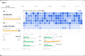
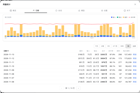
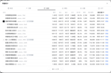
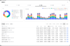
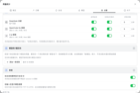
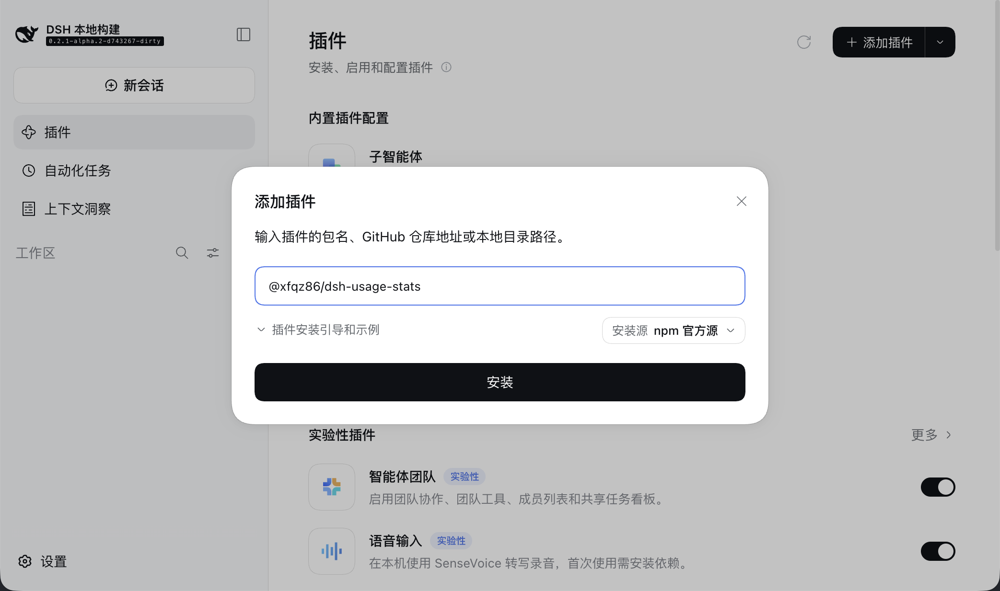

# dsh-usage-stats — DSH 用量统计插件

DSH 的 Web 用量统计插件，按模型、会话、日期三个维度统计 token 用量与调用次数，挂载于侧边栏底部展示今日用量，点击打开详情面板。

[](https://github.com/deepseek-ai/deepseek-harness)
[](https://www.npmjs.com/package/@xfqz86/dsh-usage-stats)
[](https://github.com/xfqz86/dsh-usage-stats/releases/latest/)
[](https://github.com/xfqz86/dsh-usage-stats)
[](https://github.com/xfqz86/dsh-usage-stats/blob/main/LICENSE)

## 功能

- 侧边栏底部常驻今日用量，宽列与收起状态自适应展示；点击打开详情面板
- 概览：今日与总计、每日热力图，以及下面三项额度卡片
- 按日期、会话、模型分别统计 token 用量；日期页与模型页的时间范围可切 7/14/30/90/180/365 天与全部，默认 365 天；模型页与日期、会话明细里的模型表可按厂商或按模型分组看，分组与时间范围的选择会按当前浏览器记住（日期页与模型页共用同一个时间记忆）
- 日期页每行末尾点「明细」，弹窗看这一天分别花在哪些会话、哪些模型上
- 模型页每行末尾点「明细」，弹窗看这块模型的每日用量与用它的会话
- 会话页主会话行末尾点「明细」，弹窗看这条会话的用量按日期、按模型摊开，子会话一并计入
- 模型统计重定向：可以把某个供应商的某个模型的用量算到另一个供应商的某个模型名下
- DeepSeek 余额，展示多币种余额
- OpenCode Go 额度，展示滚动 5 小时、本周、本月三档已使用额度
- Z.ai 额度，展示滚动 5 小时、本周已使用额度，以及每月 Web 搜索次数
- 关于页：版本、数据与隐私说明、统计口径（每次模型回复与上下文压缩计入用量，自动生成标题与被替换的重试不计入）、常用链接，以及检查更新；发现新版本可查看更新说明并一键升级（仅 npm 安装），当前版本领先线上时显示「本地版本较新」
- 输入区状态行显示本会话的模型速度：平均首字延迟（TTFT）与输出速度（ATPS），点开读数看每次调用的柱状图与平均/最近/最小/最大（设置里可关，默认开启）
- 会话标题旁 session-id 徽标，支持一键复制

## 界面截图

侧边栏底部：

[](https://raw.githubusercontent.com/xfqz86/dsh-usage-stats/main/docs/screenshot/footer.png)

| [](https://raw.githubusercontent.com/xfqz86/dsh-usage-stats/main/docs/screenshot/01-overview.png) | [](https://raw.githubusercontent.com/xfqz86/dsh-usage-stats/main/docs/screenshot/02-dates.png) | [](https://raw.githubusercontent.com/xfqz86/dsh-usage-stats/main/docs/screenshot/03-sessions.png) | [](https://raw.githubusercontent.com/xfqz86/dsh-usage-stats/main/docs/screenshot/04-models.png) | [](https://raw.githubusercontent.com/xfqz86/dsh-usage-stats/main/docs/screenshot/05-settings.png) |
| :---: | :---: | :---: | :---: | :---: |
| *概览* | *日期* | *会话* | *模型* | *设置* |

## 安装与卸载

### 在 DeepSeek Harness 网页版或桌面版中安装

点开 **添加插件** 弹窗，在「输入插件的包名、GitHub 仓库地址或本地目录路径」下方的输入框中填写 `@xfqz86/dsh-usage-stats`，然后点击 **安装**：



你也可以填入 `github:xfqz86/dsh-usage-stats#release`，来体验最新代码（可能包含未开发完成的功能）。

---

### 使用 `dsh` CLI 安装

```bash
# 安装最新发行版
dsh plugin --profile web add @xfqz86/dsh-usage-stats
```

```bash
# 安装最新代码版本（可能包含未开发完成的功能）
dsh plugin --profile web add github:xfqz86/dsh-usage-stats#release
```

---

### 更新插件

```sh
dsh plugin --profile web update @xfqz86/dsh-usage-stats
```

更新后重启一次 DSH 生效。

也可以打开面板的「关于」页点「检查更新」：发现新版本会直接提示，点开能看到这一版的更新说明。npm 安装的版本可直接点「立即升级」在后台装上新版，装好后重启一次 DSH 生效；用 `link:`、`github:` 等方式安装的版本不支持后台升级（弹窗里只提示手动更新），请用上面的命令行更新。

---

### 本地开发

```bash
git clone https://github.com/xfqz86/dsh-usage-stats.git
cd dsh-usage-stats
pnpm install --frozen-lockfile
pnpm build
dsh plugin --profile web add "link:$(pwd)"
# 后续改动后重新 pnpm build，浏览器刷新即可；服务端改动需重启 dsh
```

### 卸载

```bash
dsh plugin --profile web remove @xfqz86/dsh-usage-stats
```

## 设置

设置位于详情面板的设置 Tab，保存在 DSH 该 profile 的配置文件 `$DSH_HOME/profiles/<profile>/cordis.patch.yml`（`$DSH_HOME` 未设置的情况下默认为 `~/.dsh`）的 `usage-stats` 条目里。配置文件只写改过的字段。

设置 Tab 可改：三项额度监控的开关、是否在侧边栏展示、抓取间隔（最短 3 分钟），会话标题旁 session-id 徽标开关，输入区模型速度读数开关，以及模型统计重定向规则。

设置 Tab 的「配置迁移」折叠区可以把当前偏好导出成一串文本，在别的机器、别的 profile 的设置 Tab 里粘贴导入即可恢复，适合备份与两台机器对齐；分组、时间范围与折叠状态这类浏览习惯不进配置串（格式与导入规则见 `docs/API.md` §5.1）。

设置 Tab 底部的「账本操作」折叠区为清零与重建，需二次确认：清零把统计归零且不重扫历史（历史不会再回填），重建会重扫全部历史会话日志；扫描历史会话期间（面板顶部显示“扫描中…”）两项置灰不可点，等扫描结束自动恢复。

需展示额度时，在 DSH 凭据中心配置对应 Key：

- DeepSeek：`DEEPSEEK_API_KEY`
- OpenCode Go：`OPENCODE_GO_API_KEY`
- Z.ai：`ZAI_CODING_CN_API_KEY`

额度卡片会显示三种提示：未配置 Key、未订阅（仅 OpenCode Go 与 Z.ai，已配 Key 但未开通订阅；DeepSeek 余额没有这一态）、查询失败（稍后自动重试）。

凭据名完整清单与取用顺序见 `docs/API.md` §3。

## 数据存储

账本位于 `$DSH_HOME/storages/dsh-usage-stats/ledger.sqlite`：用量数据只存在本机这一份账本里，可自行备份；历史会话导入与增量更新机制见 `docs/ARCHITECTURE.md`。

「关于」页的检查更新只向 npm registry 查询最新版本、向 GitHub 读取这一版的更新说明，不上传用量、会话内容或任何账号信息；npm 安装的版本才会显示「立即升级」按钮，点它由 DSH 的插件安装链路下载新版，同样不涉及用量数据。

## 开发者

- 工程规范见 `AGENTS.md`
- 架构、数据流与统计口径见 `docs/ARCHITECTURE.md`
- 风格经验（lint 之外的统一约定）见 `docs/STYLE.md`
- 接口协议见 `docs/API.md`
- 模块结构见 `docs/STRUCTURE.md`，由 `pnpm tree` 生成
- 发布流程见 `.agents/skills/release/SKILL.md`（发版技能，可直接加载执行）
- 更新日志见 `CHANGELOG.md`，每次发版同步记录功能更新与 Bug 修复

## License

MIT